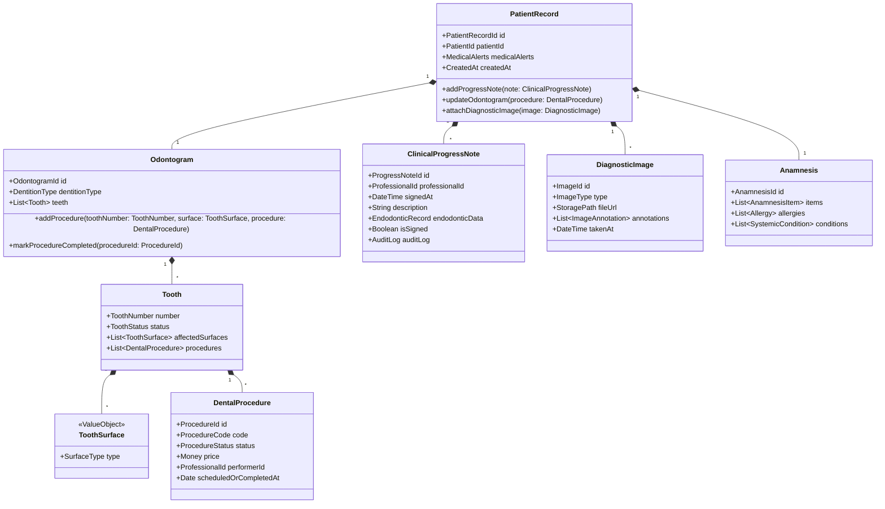

# Dental Clinic Management SaaS (Centro Odonto) - Master Architecture & Agent Blueprint

**Role:** Senior Full-Stack Software Architect & Lead Engineer  
**System Mission:** Design, architect, and implement a high-scalability dental clinic management platform (Centro Odonto) with military-grade security, LGPD compliance, and advanced clinical workflows.  
**Core Methodologies:** Domain-Driven Design (DDD), Clean Architecture (Robert C. Martin), and SOLID Principles.  
**Ubiquitous Language & Codebase Language:** **Strictly English** for all code, domain models, database schemas, API contracts, interfaces, and technical documentation.

---

## 1. Architectural & Engineering Principles

### 1.1 Clean Architecture Layers & The Dependency Rule
Dependencies **strictly point inward**. Inner layers know nothing about outer layers.

```mermaid
graph TD
    subgraph Frameworks & Drivers [External / Infrastructure Layer]
        Express[Express.js / HTTP Server]
        Postgres[(PostgreSQL)]
        Redis[(Redis / BullMQ)]
        MinIO[(MinIO / S3 Storage)]
        ExternalAPIs[WhatsApp API / Google Calendar]
    end

    subgraph Interface Adapters [Presentation & Adapters Layer]
        Controllers[HTTP Controllers / Middlewares]
        Presenters[Serializers / DTO Mappers]
        RepoImpl[Repository Implementations]
        GatewayImpl[External Gateways / Adapters]
    end

    subgraph Application Business Rules [Application Layer]
        UseCases[Use Cases / Command & Query Handlers]
        AppDTOs[Input / Output DTOs]
        ServiceInterfaces[External Service Interfaces]
    end

    subgraph Enterprise Business Rules [Domain Layer]
        Entities[Entities & Aggregates]
        ValueObjects[Value Objects]
        DomainEvents[Domain Events]
        DomainServices[Domain Services]
        RepoInterfaces[Repository Interfaces]
    end

    Frameworks --> Interface Adapters
    Interface Adapters --> Application Business Rules
    Application Business Rules --> Enterprise Business Rules
```

1. **Domain Layer (Innermost):**
   - Zero framework dependencies (no Express, no ORMs, no database drivers).
   - Contains Aggregates, Entities, Value Objects, Domain Events, Domain Exceptions, and Repository Interfaces.
   - Encapsulates invariant business rules (e.g., tooth surface validation, appointment state transitions).
2. **Application Layer:**
   - Orchestrates use cases and domain objects.
   - Defines Input/Output Data Transfer Objects (DTOs).
   - Declares abstraction interfaces for external systems (`IStorageGateway`, `IMessagingGateway`, `IPaymentGateway`, `IUnitOfWork`).
3. **Adapters & Interface Layer:**
   - Converts external protocols (HTTP requests, queue messages) into application commands/queries.
   - Implements repository interfaces using ORM/Query Builder (e.g., Prisma/Drizzle).
   - Translates domain exceptions into HTTP status codes.
4. **Infrastructure & Framework Layer (Outermost):**
   - Express server, route registrations, database connection pools, Redis clients, MinIO SDK, Docker configuration.

### 1.2 Domain-Driven Design (DDD) Tactical & Strategic Patterns
- **Bounded Contexts:** Clear modular boundary per domain area (Identity & Access, Scheduling, Clinical Record / EHR, Billing & Financial, Retention & Recall).
- **Aggregates & Aggregate Roots:** Enforce transactional consistency and domain invariants within a single boundary (e.g., `PatientRecord`, `Odontogram`, `Appointment`, `Wallet`).
- **Value Objects:** Immutable objects characterized solely by their attributes with no conceptual identity (e.g., `ToothId`, `ToothSurface`, `Money`, `DocumentCpf`, `Cnpj`, `Email`, `PhoneNumber`).
- **Domain Events:** Emitted on significant state changes (e.g., `AppointmentScheduledEvent`, `OdontogramProcedureAddedEvent`, `PaymentReceivedEvent`) to decouple bounded contexts via asynchronous dispatchers.
- **Repositories:** Abstract collections acting as domain collections, persisting and reconstructing whole aggregate roots.

### 1.3 SOLID Principles Implementation Guidelines
- **S (Single Responsibility):** Each Use Case class handles exactly one use case execution (`CreateAppointmentUseCase`, `AddClinicalEvolutionUseCase`).
- **O (Open/Closed):** Extensible via interfaces and strategy patterns (e.g., `IPaymentProvider` with `PixPaymentProvider`, `CreditCardPaymentProvider`).
- **L (Liskov Substitution):** All repository and gateway implementations adhere to contract specifications without breaking invariants.
- **I (Interface Segregation):** Granular, focused interfaces rather than fat monolith interfaces (e.g., separate `IFileReader` and `IFileWriter` or domain-specific repository contracts).
- **D (Dependency Inversion):** High-level application modules depend on domain abstractions, not low-level database/infrastructure drivers. Injected via Dependency Injection (IoC Container / Composition Root).

---

## 2. Technology Stack & Rationale

### 2.1 Backend Core
- **Runtime:** Node.js (v20+ LTS)
- **Language:** TypeScript 5.x (with `"strict": true`, `"noImplicitAny": true`, `"exactOptionalPropertyTypes": true`)
- **Web Framework:** Express.js (used purely as an HTTP engine in the Infrastructure layer)
- **Dependency Injection:** Tsyringe or InversifyJS (or functional Composition Root factories)
- **Validation:** Zod (for presentation DTO validation before passing to use cases)

### 2.2 Relational Database & ORM
- **Database: PostgreSQL 16**
  - *Rationale:* Medical and financial applications demand strict ACID compliance, robust referential integrity, strong row-level locking for financial wallets, and native `JSONB` support. `JSONB` is ideal for storing dynamic clinical evolution forms (e.g., variable endodontic instrument records, customizable anamnesis answer sheets) while keeping relational integrity for critical clinical and billing entities.
- **ORM / Persistence:** **Prisma** or **Drizzle ORM** (used strictly as a Data Mapper inside the Infrastructure layer).
  - Domain entities are never exposed or polluted by ORM annotations.
  - Infrastructure repositories query via the ORM and map raw database records to pure Domain Aggregate instances through explicit Mappers.

### 2.3 Frontend Framework Suggestion & Decision
- **Recommended Framework: Next.js 15 (App Router) + React 19 + TypeScript**
  - *Clinical UI Demands:*
    1. **Interactive Odontogram:** HTML5 Canvas / SVG powered by **Konva.js** or **Fabric.js**, enabling high-performance interactive rendering of 32 adult + 20 primary teeth, selectable surfaces (Mesial, Distal, Occlusal, Vestibular, Lingual), and real-time color-coded statuses (budgeted, planned, completed).
    2. **Diagnostic Imaging Viewer:** Canvas-based DICOM/High-res viewer with pan, zoom, contrast/brightness filters, measurement calipers, and annotation layers.
    3. **Architecture:** Next.js Server Components for secure data pre-fetching, dynamic dashboard streaming with React Suspense, and client-side modules for high-frequency interactive canvas operations.
  - **Styling & UI Components:** TailwindCSS + Radix UI primitives / Shadcn UI + Lucide Icons.
  - **State Management:** TanStack Query (React Query) for server state caching + Zustand for client canvas/odontogram tool state.

### 2.4 Caching, Queues & Object Storage
- **Queue & Async Jobs:** **Redis 7 + BullMQ**
  - WhatsApp 24-hour reminder scheduling.
  - Google Calendar 2-way sync webhook processing.
  - Automated patient recall cron jobs.
  - Image compression and thumbnail generation.
- **Object Storage (Clinical Images & PDFs):** **MinIO** (S3-compatible) in local Docker Compose, swappable to AWS S3 / Cloudflare R2 in production.

---

## 3. Ubiquitous Language (English to Portuguese Clinical Mapping)

All code identifiers must use the standard English medical terminology:

| Portuguese (Clínico) | English Ubiquitous Term | Context / Notes |
| :--- | :--- | :--- |
| Prontuário Eletrônico do Paciente (PEP) | **Electronic Health Record (EHR) / Clinical Record** | Patient medical and clinical history aggregate |
| Odontograma | **Odontogram / Dental Chart** | Interactive tooth map (FDI numbering system) |
| Dentição Permanente / Decídua | **Permanent / Primary Dentition** | 32 adult teeth vs. 20 pediatric teeth |
| Faces do Dente (M, D, O/I, V/B, L/P) | **Tooth Surfaces (Mesial, Distal, Occlusal/Incisal, Vestibular/Buccal, Lingual/Palatal)** | Value Object representing targeted surfaces |
| Procedimento Odontológico | **Dental Procedure** | Treatment linked to tooth/surface or general |
| Orçamento / Plano de Tratamento | **Treatment Plan / Estimate** | Proposed vs approved vs completed |
| Evolução Clínica | **Clinical Progress Note / Clinical Evolution** | Immutable, audited timestamped record |
| Odontometria / Endodontia | **Odontometry / Endodontics** | Working length, reference points, sealers |
| Radiografia / Tomografia (TCFC) | **Diagnostic Imaging / X-Ray / CBCT Scan** | Periapical, panoramic, bitewing, CBCT slices |
| Anamnese | **Anamnesis / Medical History** | Health background, medical alerts, risk factors |
| Prescrição Eletrônica | **Electronic Prescription** | Medication, dosage, instructions, digital signature |
| Agenda de Consultas | **Scheduling / Appointment Calendar** | Booking slots, durations, dentist allocations |
| Fila de Espera | **Waiting List / Standby Queue** | Automated slot re-allocation |
| Carteira / Crédito do Paciente | **Patient Wallet / Prepaid Credit** | Account balance, session deductions |
| Fluxo de Caixa (Contas a Pagar/Receber) | **Cash Flow (Accounts Payable / Receivable)** | Financial ledger and transactions |
| Motor de Retorno / Recall | **Patient Recall Engine** | Chronological triggers for preventive returns |

---

## 4. Domain Modeling: Clinical Record Context (EHR)

Below is the initial tactical DDD model for the core **Clinical Record Bounded Context**.



### 4.1 Invariants & Business Rules
1. **Clinical Note Immutability:** Once signed by a dental professional, a `ClinicalProgressNote` cannot be edited or deleted. Amendments must be created as new linked addendum notes (`AddendumNote`) referencing the original note ID.
2. **FDI Tooth Numbering Validation:** Teeth must follow the two-digit ISO/FDI system:
   - Permanent: `11-18`, `21-28`, `31-38`, `41-48`.
   - Primary: `51-55`, `61-65`, `71-75`, `81-85`.
3. **Audit Trail Compliance:** Every clinical action, view of sensitive patient medical data, and image export logs an audit record containing `actor_id`, `actor_role`, `action_type`, `ip_address`, and `timestamp`.

---

## 5. Clean Architecture Project Directory Structure

```
centro-odonto/
├── .github/
├── docker/
│   ├── backend/
│   │   ├── Dockerfile
│   │   └── Dockerfile.dev
│   ├── frontend/
│   │   ├── Dockerfile
│   │   └── Dockerfile.dev
│   └── minio/
├── docker-compose.yml
├── docker-compose.override.yml.example
├── .env.example
├── package.json
│
├── backend/                             # Express + TypeScript Clean Architecture
│   ├── package.json
│   ├── tsconfig.json
│   ├── tsconfig.build.json
│   ├── prisma/
│   │   ├── schema.prisma
│   │   └── migrations/
│   ├── src/
│   │   ├── main/                        # Composition Root & App Setup
│   │   │   ├── config/                  # Environment variables, app configuration
│   │   │   ├── container/               # Dependency Injection Container bindings
│   │   │   ├── server.ts                # Express server listener
│   │   │   ├── app.ts                   # Express app configuration & middleware
│   │   │   └── routes.ts                # Master HTTP route aggregator
│   │   │
│   │   ├── shared/                      # Shared Kernel across contexts
│   │   │   ├── domain/
│   │   │   │   ├── AggregateRoot.ts
│   │   │   │   ├── Entity.ts
│   │   │   │   ├── Identifier.ts
│   │   │   │   ├── ValueObject.ts
│   │   │   │   ├── Result.ts
│   │   │   │   └── DomainEvent.ts
│   │   │   ├── application/
│   │   │   │   ├── IUseCase.ts
│   │   │   │   └── AppError.ts
│   │   │   └── infrastructure/
│   │   │       ├── database/            # PrismaClient / database connection
│   │   │       ├── logger/              # Pino logger
│   │   │       ├── event-bus/           # In-memory / Redis event bus
│   │   │       └── middleware/          # Auth, RoleGuard, RateLimiter, ErrorHandler
│   │   │
│   │   └── modules/                     # Bounded Contexts
│   │       ├── identity-access/         # Auth, Users, Roles (RBAC)
│   │       │   ├── domain/
│   │       │   ├── application/
│   │       │   └── infrastructure/
│   │       │
│   │       ├── clinical-record/         # EHR, Odontogram, Progress Notes, Images
│   │       │   ├── domain/
│   │       │   │   ├── aggregates/      # PatientRecord.ts, Odontogram.ts
│   │       │   │   ├── entities/        # Tooth.ts, DentalProcedure.ts, ClinicalProgressNote.ts
│   │       │   │   ├── value-objects/   # ToothNumber.ts, ToothSurface.ts, MedicalAlert.ts
│   │       │   │   ├── events/          # ProcedureCompletedEvent.ts
│   │       │   │   └── repositories/    # IPatientRecordRepository.ts (contract)
│   │       │   ├── application/
│   │       │   │   ├── use-cases/       # AddProgressNoteUseCase.ts, UpdateOdontogramUseCase.ts
│   │       │   │   ├── dtos/            # AddProgressNoteDTO.ts, OdontogramDTO.ts
│   │       │   │   └── services/        # IStorageService.ts (contract)
│   │       │   └── infrastructure/
│   │       │       ├── http/            # ClinicalRecordController.ts, clinicalRecordRoutes.ts
│   │       │       ├── persistence/     # PrismaPatientRecordRepository.ts, PatientRecordMapper.ts
│   │       │       └── storage/         # MinioStorageService.ts
│   │       │
│   │       ├── scheduling/              # Appointments, Calendar Sync, Waiting List
│   │       │   ├── domain/
│   │       │   ├── application/
│   │       │   └── infrastructure/
│   │       │
│   │       ├── billing/                 # Patient Wallet, Cashflow, Pix Gateway
│   │       │   ├── domain/
│   │       │   ├── application/
│   │       │   └── infrastructure/
│   │       │
│   │       └── recall/                  # Automated Patient Recall Engine
│   │           ├── domain/
│   │           ├── application/
│   │           └── infrastructure/
│   │
│   └── tests/
│       ├── unit/                        # Tests for Domain Entities and Use Cases (No DB required)
│       ├── integration/                 # Tests for Repositories and HTTP Controllers
│       └── e2e/                         # Full pipeline API tests with test DB
│
└── frontend/                            # Next.js 15 + React 19 + TailwindCSS
    ├── package.json
    ├── tsconfig.json
    ├── next.config.ts
    ├── tailwind.config.ts
    ├── src/
    │   ├── app/                         # Next.js App Router (pages & layouts)
    │   │   ├── (auth)/                  # Login, Tenant selection
    │   │   └── (dashboard)/             # Protected Clinic SaaS App
    │   │       ├── patients/
    │   │       │   └── [id]/
    │   │       │       ├── odontogram/  # Interactive Canvas Odontogram
    │   │       │       ├── history/     # Clinical Notes timeline
    │   │       │       └── imaging/     # Diagnostic Image viewer & caliper tools
    │   │       ├── schedule/            # Calendar view & appointment status pipeline
    │   │       ├── billing/             # Wallet, Cash Flow & Invoicing
    │   │       └── settings/
    │   ├── components/
    │   │   ├── ui/                      # Base Radix / Shadcn components
    │   │   ├── odontogram/              # Konva/Canvas interactive tooth charting
    │   │   └── viewer/                  # Medical image viewer & annotation tools
    │   ├── hooks/                       # Custom React hooks
    │   ├── lib/                         # API client (Axios / Fetch), utilities
    │   └── stores/                      # Zustand state stores (Odontogram selection state)
```

---

## 6. Docker & Infrastructure Blueprint (`docker-compose.yml`)

The complete local environment runs in isolated containers:
1. **`postgres`**: PostgreSQL 16 with pre-configured healthcheck and persistent volumes.
2. **`redis`**: Redis 7 Alpine for queues and caching.
3. **`minio`**: MinIO S3 Object Storage for dental X-rays, CBCT scans, and signed PDF prescriptions.
4. **`minio-create-buckets`**: Automatic initialization job creating required clinical storage buckets.
5. **`backend`**: Node.js 20 Express development server with live reload (`tsx` / `nodemon`).
6. **`frontend`**: Next.js development server with hot-module reloading.

---

## 7. Security, LGPD Compliance & Auditability

1. **Data at Rest & Transit:** Sensitive medical and patient identity data (CPF, Anamnesis notes) encrypted using AES-256 / PostgreSQL `pgcrypto` at rest; TLS 1.3 in transit.
2. **Access Control & Clinical Data Protection:** Strict Role-Based Access Control (RBAC) preventing unauthorized access across administrative, clinical, and financial operations.
3. **Role-Based Access Control (RBAC):**
   - `ADMIN`: Full clinic management, financial reports, team configurations.
   - `DENTIST`: Full access to Clinical Records, Odontogram, Prescriptions, assigned appointments.
   - `RECEPTIONIST`: Scheduling, Reception check-in, patient registration, basic billing/wallet top-up.
   - `FINANCIAL`: Accounts payable/receivable, ledger reconciliation.
4. **Digital Signatures:** Prescriptions and Clinical Notes ready for ICP-Brasil compliant digital signatures (X.509 certificates).

---

## 8. Implementation Roadmap & Phased Execution

- **Phase 1: Environment & Project Foundation**
  - Setup root repository, Docker Compose infrastructure (`postgres`, `redis`, `minio`), environment files.
  - Initialize `backend` TypeScript project with Clean Architecture base classes (`AggregateRoot`, `Entity`, `ValueObject`, `Result`).
  - Configure database connection, migration workflow, and Prisma schema.
- **Phase 2: Identity & Access Management (IAM & RBAC)**
  - User domain modeling, credentials hashing, and Role-Based Access Control (ADMIN, DENTIST, RECEPTIONIST, FINANCIAL).
  - JWT Authentication, Refresh Token, and RoleGuard middleware.
  - Clinic Profile configuration (branding, CNPJ, clinic contact details).
- **Phase 3: Clinical Record & Odontogram (Core Domain)**
  - Tactical domain models for `Patient`, `PatientRecord`, `Odontogram`, `Tooth`, `DentalProcedure`, `ClinicalProgressNote`.
  - Use cases: Add/Update Odontogram procedure, Sign Clinical Note, Upload Diagnostic Image.
  - MinIO integration for image storage.
- **Phase 4: Scheduling & Pipeline Engine**
  - Appointment aggregate with state machine: `SCHEDULED` -> `CONFIRMED` -> `IN_RECEPTION` -> `IN_CONSULTATION` -> `COMPLETED` / `NO_SHOW`.
  - BullMQ integration for automated 24-hour reminders and WhatsApp webhooks.
- **Phase 5: Financial Wallet & Cash Flow**
  - Patient Wallet aggregate, Pix QR Code integration, and session deductions.
- **Phase 6: Frontend Development & Odontogram Canvas**
  - Next.js 14/15 setup, authentication flow, design system.
  - Interactive HTML5 Canvas Odontogram component with bidirectional syncing to backend.